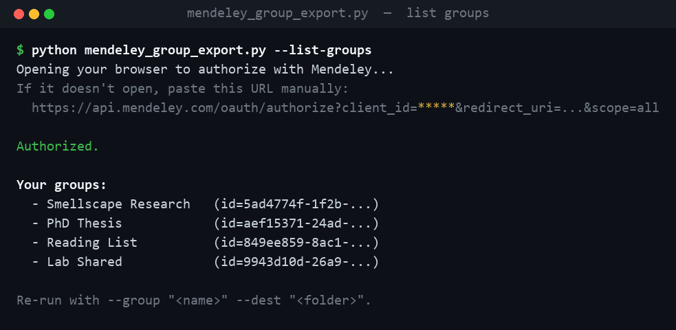
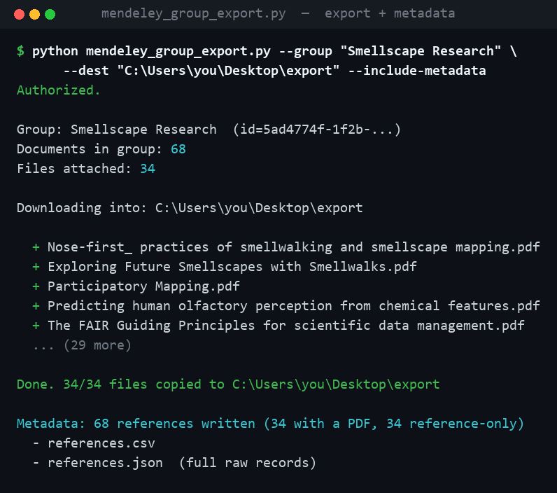

# Mendeley tools

[](LICENSE)

-green.svg)

Small utilities for getting your data **out** of a Mendeley account. Pure
Python standard library — no `pip install`, no third-party packages.

The headline tool, **`mendeley_group_export.py`**, copies every file attached
to a specific Mendeley **group** into a folder on disk — each PDF named by its
document title — and can optionally export the full reference list as CSV/JSON.

---

## Why this tool exists

The current **Mendeley Reference Manager** (the Electron desktop app that
replaced Mendeley Desktop) stores your library in a local **IndexedDB /
LevelDB** store, and it saves the attached PDFs in a flat folder where every
file is named by an opaque hash:

```
...\AppData\Roaming\Mendeley Reference Manager\userfiles\
    0001ea0f-4267-e0f1-5ac1-a22d1ffc81ff.pdf
    0099801a-6db4-be35-74d3-37708fdff054.pdf
    ...
```

There is **no title, no author, and no group** in those filenames, and the app
has **no "export all files in this group to a folder"** feature. So if you just
want *"all the PDFs from my `Smellscape Research` group, named sensibly, in one
folder"* — to share with a collaborator, hand to a reference-free tool, or
archive — there is no clean way to do it from the app, and digging through the
binary local database is fragile.

This tool sidesteps all of that by talking to the **Mendeley REST API**
(`api.mendeley.com`). Your references live on Mendeley's servers, so it asks the
server directly: *"which documents are in this group, and what files are
attached?"* — then downloads them with real names. It never reads or modifies
Mendeley's local data folders.

## What it looks like

**1. Authorize once in the browser, then list your groups:**



**2. Export a group's files (optionally with a reference metadata dump):**



## How it works

1. **OAuth2 (authorization-code flow).** On launch it opens your browser to
   Mendeley's authorization page and runs a one-shot local web server on
   `http://localhost:8080/callback` to catch the returned code, which it
   exchanges for an access token. The token lives only in memory — it is never
   written to disk.
2. **Find the group.** `GET /groups` → match your group by name.
3. **List documents.** `GET /documents?group_id=…&view=all` (paginated via the
   `Link: rel="next"` header) → gives titles, authors, year, identifiers.
4. **List files.** `GET /files?group_id=…` → the files actually attached to
   documents in that group.
5. **Download each file.** `GET /files/{id}` returns a `303` redirect to a
   short-lived signed URL; the tool follows it and saves the PDF named by its
   document's title (de-duplicating collisions with ` (2)`, ` (3)`, …).
6. **(Optional) Metadata.** With `--include-metadata` it writes `references.csv`
   and `references.json` covering **every** reference in the group — including
   the ones that have no PDF attached, which the file export alone would miss.

## Setup

### One-time: register a Mendeley API app

1. Go to <https://dev.mendeley.com/myapps.html> and sign in.
2. Create a new app. Set the **Redirect URL** to exactly:
   `http://localhost:8080/callback`
3. Copy the **Client ID** and generate a **Secret**.
4. Copy `.env.example` to `.env` and paste your Client ID and Secret in.
   (`.env` is git-ignored — your secret never gets committed.)

## Usage (PowerShell)

```powershell
# Load credentials from .env (see the comment block in .env.example), or set:
$env:MENDELEY_CLIENT_ID     = "<client id>"
$env:MENDELEY_CLIENT_SECRET = "<secret>"

# 1. Dry run — authorize in the browser and list your groups (downloads nothing)
python mendeley_group_export.py --list-groups

# 2. Copy one group's files out, named by document title
python mendeley_group_export.py --group "Exact Group Name" --dest "C:\path\to\out"

# 3. ...and also write references.csv + references.json for EVERY reference
#    in the group (including those with no attached PDF)
python mendeley_group_export.py --group "Exact Group Name" --dest "C:\path\to\out" --include-metadata
```

If `--group` is omitted or doesn't match, the script prints all your groups and
exits so you can copy the exact name.

### `--include-metadata`

Writes two files into the destination folder:

- **`references.csv`** — one row per reference (title, authors, year, type,
  source, doi, isbn, issn, pmid, `has_pdf`, `pdf_filename`, id), sorted by year
  then title. UTF-8 with BOM so Excel opens accented characters cleanly.
- **`references.json`** — the full raw document records from the API.

## Notes & safety

- **Download-only.** Nothing in Mendeley's own local data folders is read,
  moved, renamed, or deleted. All data comes from the server over HTTPS.
- **Secrets stay local.** The client secret lives only in your git-ignored
  `.env`; the OAuth token is held in memory for the run and never persisted.
- Requires Python 3.8+ (standard library only).

## License

Copyright (C) 2026 David Cuartielles.

This project is free software licensed under the **GNU General Public License
v3.0 or later (GPL-3.0-or-later)**. See [LICENSE](LICENSE) for the full text.
It comes with **no warranty**. Mendeley is a trademark of Elsevier; this is an
independent tool and is not affiliated with or endorsed by Mendeley/Elsevier.
